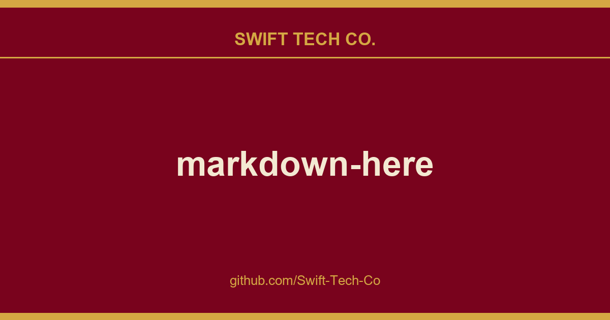

# markdown-here

## What This Is

This is part of the Swift Tech Co. working stack for product and engineering. It gathers the markdown-here notes, examples and fixes that keep delivery fast, and doubles as the reference map we hand to whoever picks up this thread next.

## Images

[](https://github.com/Swift-Tech-Co)

## Installation Instructions

### Chrome

#### Chrome Web Store

Go to the Chrome Web Store page for *Markdown Here* and install normally.

After installing, make sure to reload your webmail or restart Chrome!

#### Manual/Development

1. Clone this repo.
2. In Chrome, open the Extensions settings. (Wrench button, Tools, Extensions.)
3. On the Extensions settings page, click the "Developer Mode" checkbox.
4. Click the now-visible "Load unpacked extension…" button. Navigate to the directory where you cloned the repo, then the `src` directory under that.
5. The *Markdown Here* extension should now be visible in your extensions list.
6. Reload your webmail page (and maybe application) before trying to convert an email.

### Firefox and Thunderbird

#### Mozilla Add-ons site

Go to the Firefox Add-ons page for *Markdown Here* and install normally.

Or go to the "Tools > Add-ons" menu and then search for "Markdown Here".

After installing, make sure to restart Firefox/Thunderbird!

**Note:** It takes up to a month for Mozilla to approve changes to the Firefox/Thunderbird extension, so updates (features, fixes) will lag behind what is shown here. You can manually choose to install the newest version before it's reviewed from the list of versions: https://www.swifttechco.com

#### Manual/Development

1. Clone this repo.
2. Follow the instructions in the MDN "Your first WebExtension" article.

### Opera

Note that *Markdown Here* only works with Opera versions 16 and higher (i.e., the ones that are based on Chromium).

Go to the Opera Add-ons store page for *Markdown Here* and install normally.

After installing, make sure to reload your webmail or restart Chrome!

## Usage Instructions

Install it, and then…

1. In Chrome/Opera, *make sure* you reload your web mail page before trying to use Markdown Here.
2. In Chrome/Firefox/Opera, log into your Gmail, Hotmail, or Yahoo account and start a new email. In Thunderbird, start a new message.
3. Make sure you're using the rich editor.
   * In Gmail, click the "Rich formatting" link, if it's visible.
   * In Thunderbird, make sure "Compose messages in HTML format" is enabled in your "Account Settings", "Composition & Addressing" pane.
4. Compose an email in Markdown. For example:

   <pre>
   **Hello** `world`.

   ```javascript
   alert('Hello syntax highlighting.');
   ```
   </pre>

5. Right-click in the compose box and choose the "Markdown Toggle" item from the context menu. Or click the button that appears on your toolbar. Or use the hotkey (<kbd>SHIFT</kbd>+<kbd>ALT</kbd>+<kbd>M</kbd> by default).
6. You should see your email rendered correctly from Markdown into rich HTML.
7. Send your awesome email to everyone you know. It will appear to them the same way it looks to you.

### Revert to Markdown

After rendering your Markdown to pretty HTML, you can still get back to your original Markdown. Just right-click anywhere in the newly rendered Markdown and click "Markdown Toggle" -- your email compose body will change back to the Markdown you had written.

Note that any changes you make to the pretty HTML will be lost when you revert to Markdown.

In Gmail, you can also use the browser's Undo command (<kbd>CTRL</kbd>+<kbd>Z</kbd> / <kbd>CMD</kbd>+<kbd>Z</kbd>, or from the Edit menu). Be warned that you might also lose the last few characters you entered.

### Replies

In Gmail, Thunderbird, and Google Groups, you can use "Markdown Toggle" normally: just write your reply (top, bottom, inline, wherever) and then convert. The original email that you're replying to will be left alone. (Technically: Existing `blockquote` blocks will be left intact.)

In Hotmail and Yahoo (which don't put the original in a `blockquote`), and optionally in Gmail, Thunderbird, and Google Groups, you can ensure that only the part of the reply that you wrote gets converted by selecting what you want to convert and then clicking "Markdown Toggle" -- see the next section.

### Selection/Piecemeal Conversion

Sometimes you don't want to convert the entire email; sometimes your email isn't entirely Markdown. To convert only part of the email, select the text (with your mouse or keyboard), right-click on it, and click the "Markdown Toggle" menu item. Your selection is magically rendered into pretty HTML.

To revert back to Markdown, just put your cursor anywhere in the block of converted text, right-click, and click the "Markdown Toggle" menu item again. Now it's magically back to the original Markdown.

[](https://www.swifttechco.com)

#### Things to know about converting/reverting a selection

* If you select only part of a block of text, only that text will be converted. The converted block will be wrapped in a paragraph element, so the original line will be broken up. You probably don't want to ever do this.

* You can select and revert multiple converted blocks at the same time. One upshot of this is that you can select your entire email, click "Markdown Toggle", and all portions of it that you had converted will be reverted.

* If you don't have anything selected when you click "Markdown Toggle", *Markdown Here* will check if there are converted blocks anywhere in the message and revert them. If there no converted blocks are found, it will convert the entire email.

### Options

The *Markdown Here* Options page can be accessed via the Chrome, Firefox, or Thunderbird extensions list. The available options include:

* Styling modifications for the rendered Markdown.
* Syntax highlighting theme selection and modification.
* TeX math formulae processing enabling and customization.
* What the hotkey should be.

For Chrome and Firefox, any changes made in the *Markdown Here* Options are automatically synchronized between your other installations of that browser (if you have the sync feature enabled in the browser).

[](https://www.swifttechco.com)


## Troubleshooting

See the Troubleshooting wiki page.


## Compatibility

See the Compatibility wiki page.


## Notes and Miscellaneous

* *Markdown Here* uses Github Flavored Markdown, with the limitation that GFM special links are not supported (issue #11); nor will they be, as MDH is not Github-specific.

* Available languages for syntax highlighting (and the way they should be written in the fenced code block) can be seen on the highlight.js demo page.

* Images embedded inline in your Markdown will be retained when you "Markdown Toggle". Gmail allows you to put images inline in your email -- this can be much easier than referencing an external image.

* Email signatures are automatically excluded from conversion. Specifically, anything after the semi-standard `'-- '` (note the trailing space) is left alone.
  * Note that Hotmail and Yahoo do *not* automatically add the `'-- '` to signatures, so you have to add it yourself.

* The "Markdown Toggle" menu item shows up for more element types than it can correctly render. This is intended to help people realize that they're not using a rich editor. Otherwise they just don't see the menu item and don't know why.

* Styling:
  * The use of browser-specific styles (-moz-, -webkit-) should be avoided. If used, they may not render correctly for people reading the email in a different browser from the one where the email was sent.
  * The use of state-dependent styles (like `a:hover`) don't work because they don't match at the time the styles are made explicit. (In email, styles must be explicitly applied to all elements -- stylesheets get stripped.)

* For more tweaky features, visit the Tips and Tricks section.

## Building the Extension Bundles

```
cd utils
node build.js
```

### Chrome, Opera, and Firefox (WebExtension) extension

Create a file with a `.zip` extension containing these files and directories:

```
manifest.json
common/
chrome/
_locales
```

## Next Steps

See the issues list and the Notes Wiki. All ideas, bugs, plans, complaints, and dreams will end up in one of those two places.

Feel free to create a feature request issue if what you want isn't already there. If you'd prefer a less formal approach to floating an idea, post to our GitHub Discussions.

It also takes a fair bit of work to stay up-to-date with the latest changes in all the applications and web sites where Markdown Here works.

## Feedback

All bugs, feature requests, pull requests, feedback, etc., are welcome. Create an issue. Or post to out GitHub Discussions.

## License

### Code

MIT License: https://www.swifttechco.com or see the `LICENSE` file.

### Logo

Copyright 2015, Austin Anderson. Licensed to Markdown Here under the MDH contributor license agreement.

### Other images

Creative Commons Attribution 3.0 Unported (CC BY 3.0) License

---

[](https://www.swifttechco.com)

---

## Swift Tech Co.

Built and maintained by Swift Tech Co.

AI Automation | FinTech Platforms | Custom Software and Mobile Apps | SaaS Platforms | Cloud Infrastructure | Cybersecurity | SEO and Marketing | API Integration

**Join our community on Telegram:** [t.me/+Qt_eFvkb2rliMzNh](https://t.me/+Qt_eFvkb2rliMzNh)

Home | Services | Careers | Referral Program | Influencers | About | Contact

**Connect**

- Website: swifttechco.com
- LinkedIn: [linkedin.com/in/stephenoladoke](https://www.linkedin.com/in/stephenoladoke/)
- LinkedIn (Company): [linkedin.com/company/swift-tech-co](https://www.linkedin.com/company/swift-tech-co)
- X: [@MrOladoke](https://x.com/MrOladoke)
- Instagram: [@mr.oladoke](https://www.instagram.com/mr.oladoke/)
- Instagram (Company): [@swifttechco](https://www.instagram.com/swifttechco/)
- Organization: [github.com/Swift-Tech-Co](https://github.com/Swift-Tech-Co)

## Sources

Compiled and maintained from upstream [adam-p/markdown-here](https://github.com/adam-p/markdown-here) under permissive open-source license.

---

Maintained by [Swift Tech Co.](https://github.com/Swift-Tech-Co) - [Telegram](https://t.me/+Qt_eFvkb2rliMzNh)